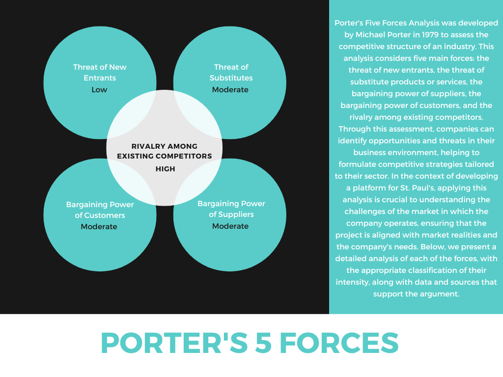
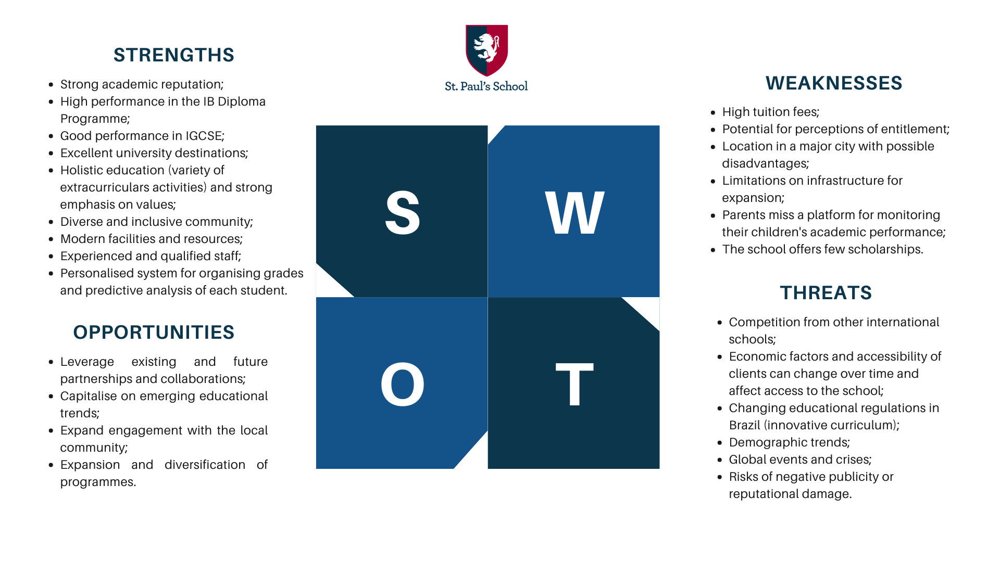
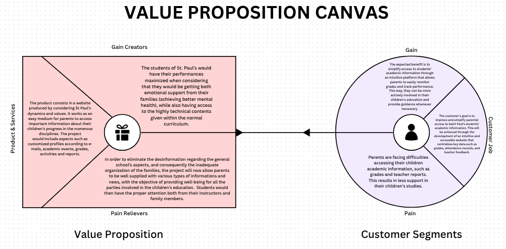
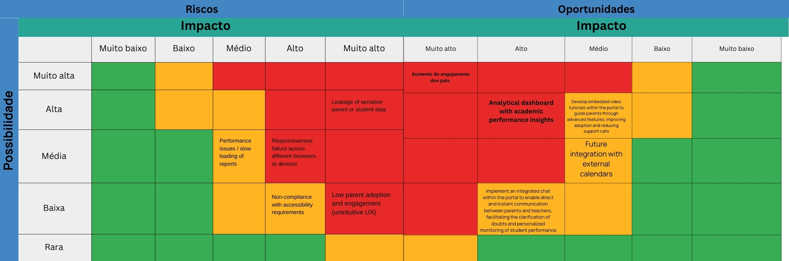

# WAD - Web Application Document - 2nd Module - Inteli

<!-- **_Os trechos em itálico servem apenas como guia para o preenchimento da seção. Por esse motivo, não devem fazer parte da documentação final_** -->

## Group name: CrownMates
## Project name: Diana

#### Group members' names:

- <a href="https://www.linkedin.com/in/anneestherlf/">Anne Esther Lins Figueirôa</a>
- <a href="https://www.linkedin.com/in/giacomo-zema-matizonkas-7ab9072b2/">Giacomo Zema Matizonkas</a>
- <a href="https://www.linkedin.com/in/jaime-andrade-de-almeida-0777ba2a5/">Jaime Andrade de Almeida</a> 
- <a href="https://www.linkedin.com/in/karolbarbosarocha/">Karol Rocha Barbosa</a> 
- <a href="https://www.linkedin.com/in/let%C3%ADcia-saravia-619b73345/">Leticia Fernandes do Espírito Santo Saravia</a>
- <a href="https://github.com/nicholasmillani">Nicholas Anantha Krishnan Millani</a> 
- <a href="https://www.linkedin.com/in/victor-garcia-dos-santos/">Víctor Garcia dos Santos</a>

## Summary

[1. Introduction](#c1)

[2. Overview of the Web Application](#c2)

[3. Web Application's Technical Project](#c3)

[4. Web Application Development](#c4)

[5. Web Application Tests](#c5)

[6. Market Research and Marketing Plan](#c6)

[7. Conclusions and future work](#c7)

[8. References](c#8)

[Appendices](#c9)

 

# 1. Introduction (sprints 1 to 5)

&nbsp;&nbsp;&nbsp;&nbsp;St. Paul’s is a British school located in São Paulo, with nearly 100 years of history. The school identified a problem in the experience of its students’ parents: the official mobile app, used as the main communication channel, presents many limitations. Academic information such as homework, class schedules, number of absences, and announcements are not always available or are difficult to access via mobile phone, which causes disorganization in following their children's school life.

&nbsp;&nbsp;&nbsp;&nbsp;With the aim of solving this issue, St. Paul’s proposed a challenge to first-year students at Inteli: to develop a web portal aimed at parents. The proposal is to offer a platform accessible through a web browser, in a clear, organized, and easy-to-use format. The system will feature a simple and intuitive login screen, students’ personal information, class schedules, absence tracking, as well as a reports section to access information on child's academic performance in a visual way (dashboard).

&nbsp;&nbsp;&nbsp;&nbsp;The project considers the main concerns reported by parents regarding the structure that the school already has. The solution seeks to add value to the community, promoting more efficient communication and encouraging more active participation from parents in their children’s educational journey.

&nbsp;&nbsp;&nbsp;&nbsp;In this way, with more efficient access to information, parents will be able to follow their children’s academic performance more closely and with greater peace of mind.

# 2. Overview of the Web Application (sprint 1)

## 2.1. Project Scope (sprints 1 & 4)

### 2.1.1. 5 forces of Porter's model (sprint 1)

 

  
  Figure 01 - Porter's 5 forces

  
   
   
  
   
   

  
  Source: authors and partner's website (2025)
  

 

### 2.1.2. SWOT Analysis of the Partner Institution (sprint 1)

&nbsp;&nbsp;&nbsp;&nbsp;St Paul's School boasts a strong academic reputation and a comprehensive international curriculum, propelling its students to prestigious universities globally. Its holistic education and diverse community are strengths. However, the high cost of tuition limits accessibility and can generate perceptions of elitism. The school also faces challenges with its current infrastructure, which prevents significant expansion. Despite this, there are opportunities to strengthen partnerships, adopt innovative educational trends and increase engagement with the local community. Competition from other international schools and economic instability pose constant threats. This concludes the definition of the institution's SWOT analysis.

 

  
  Figure 02 - SWOT Analysis Chart
   
   
  
   
   

  
  Source: authors and partner's website (2025)
  

 

### 2.1.3. Solution (sprints 1 to 5)

**1. Problem to be solved**

&nbsp;&nbsp;&nbsp;&nbsp;The software currently used to access student records at the school is not effectively addressing the problems, especially for parents, who need a well-structured system to better visualize and closely follow their children's daily lives — including grades, assignments, homework, field trips, and more.

**2. Available data**

&nbsp;&nbsp;&nbsp;&nbsp;Alongside the TAPI (project deliverables document), we received the school’s brandbook for visual identity. For initial development, the partner provided mock data, including: "Pupils Contacts" (spreadsheet with fake details), profile photos, and 3 sample grade reports (PDF). We also obtained real data on student age range and total enrollment (Source: St Paul’s). This ensured privacy while allowing functional testing. 

**3. Proposed solution**

&nbsp;&nbsp;&nbsp;&nbsp;A new software solution that serves as a student history consultant, but in a simpler, more communicative, and direct way — truly making life easier for the parents who will use it. It will work as s manageable Parent Portal, with the academic information so that parents can access their children's reports, absences, communications, calendars and assigned tasks in a centralised way.

**4. How the solution will be used**

&nbsp;&nbsp;&nbsp;&nbsp;Log in via browser using your registered email and default password (schoolID — change it after first login). View your child’s profile, photo, and academic year, or switch between siblings. Check reports (PDF), attendance, and timetables. Assignments sync from Microsoft Teams. Update personal/medical details securely. Teachers’ contacts are listed for quick communication. A desktop-friendly alternative to the app, designed for clarity and convenience. 

**5. Expected benefits**

&nbsp;&nbsp;&nbsp;&nbsp;The portal enhances parental engagement by providing organized academic tracking, improving the school's reputation and reducing service congestion. Ahead of St. Paul’s 2026 centennial, this infrastructure renewal allows parents to monitor grades, attendance, and assignments efficiently while syncing academic calendars with family schedules. Centralized access empowers informed support for students’ progress. 

**6. Success criteria and how it will be evaluated**

&nbsp;&nbsp;&nbsp;&nbsp;The criterion for success is the full functionality of the software, which will be assessed by the approval of the general public of testers in this first restricted version of the software. The more specific indicators would be:

- Constant communication with parents;
- Positive feedback at meetings;
- Good personal organisation of families;
- Greater attendance at school events;
- Students getting closer to their guardians.

### 2.1.4. Value Proposition Canvas (sprint 1): 

&nbsp;&nbsp;&nbsp;&nbsp;The Value Proposition Canvas is a tool that helps to better understand what customers really need and how a solution can efficiently meet those needs. It is part of the broader model called the Business Model Canvas, used to structure ideas and businesses in a clear way. In the Value Proposition Canvas, the focus is on connecting what is offered (product or service) with the expectations, desires, and difficulties of the people who will use it. This allows for the development of solutions that are more aligned with what the audience truly values, increasing the chances of success in the market.

 

  
  Figure 03 - Value Proposition Canvas
   
   
  
   
   

  
  Source: authors and partner's website (2025)
  

 

### 2.1.5. Project Risk Matrix (Sprint 1)

&nbsp;&nbsp;&nbsp;&nbsp;According to Tomaz, Gagliasso, and Malavota (2020), the risk matrix is a management tool that assists a project team in identifying the risks and threats that may negatively affect its execution. It is constructed by combining the likelihood of each event occurring with the impact it would have if it materializes. 

 

  
  Figure 04 - Risk Matrix
   
   
  
   
   

  
  Source: authors and partner's website (2025)
  

 

#### 2.1.5.1. Risk Matrix

| Risk                                                         | Probability | Impact     | Action Plan                                                                                                                                                                                                                                                                                |
|--------------------------------------------------------------|------------:|-----------:|--------------------------------------------------------------------------------------------------------------------------------------------------------------------------------------------------------------------------------------------------------------------------------------------|
| **Leakage of sensitive data belonging to parents or students** | High        | Very High  | To mitigate the risk of sensitive data leakage, we will implement end-to-end encryption across all communication channels and storage.                                                                                                                                                     |
| **Performance issues or report latency**                     | Medium      | Medium     | To prevent performance issues, we will optimize database queries and indexes, adopt a caching layer for static reports, and monitor response-time indicators using APM tools configured with alerts for early detection of bottlenecks.                                                      |
| **Responsiveness failures on browsers/devices**               | Medium      | High       | To ensure responsiveness across various devices, we will apply responsive design based on a design system, conduct both manual and automated tests on popular browsers, and review the interface at each sprint before releasing new versions.                                               |
| **Non-compliance with accessibility requirements**           | Low         | Medium     | To ensure compliance with accessibility standards, we will perform testing with users who have special needs.                                                                                                                                                                               |
| **Low parental adoption and engagement (non-intuitive UX)**  | Low         | Very High  | To increase parental adoption, we will conduct usability sessions with real users, iterate on prototypes based on feedback, and develop onboarding materials along with synchronous training sessions to facilitate platform use.                                                             |

#### 2.1.5.2. Opportunity Matrix

| Opportunity                                                  | Probability  | Impact    | Action Plan                                                                                                                                                                                                                                                        |
|--------------------------------------------------------------|-------------:|----------:|---------------------------------------------------------------------------------------------------------------------------------------------------------------------------------------------------------------------------------------------------------------------|
| **Increase in parental engagement**                          | Very High    | Very High | To capitalize on this opportunity, we will introduce gamification elements such as badges and achievements, send personalized progress reports at regular intervals, and organize online events to strengthen the connection between school and family.           |
| **Analytical dashboard with academic performance insights** | High         | High      | To deliver analytical value, we will gather requirements from teachers and coordinators, develop interactive visualizations (charts, heatmaps), and integrate real-time engagement and learning metrics.                                                            |
| **Embedded video tutorials within the portal**               | High         | Medium    | To facilitate the adoption of advanced features, we will produce targeted scripts and integrate them seamlessly into the user interface.                                                                                                                           |
| **Future integration with external calendars**               | Medium       | Low       | To extend the system’s utility, we will evaluate the APIs of Google Calendar and Microsoft Outlook for potential integration.                                                                                                                                     |
| **Implementation of an integrated chat between parents and teachers** | Low | High | To improve communication, we will prototype a chat solution using Socket.io or Firebase Realtime Database, establish clear moderation and privacy policies, and conduct controlled pilot tests prior to full deployment. |

*This matrix will be reviewed at the beginning of each sprint, with probabilities, impacts, and action plans adjusted according to project progress.*

## 2.2. Personas (sprint 1)

*Posicione aqui suas Personas em forma de texto markdown com imagens, ou como imagem de template preenchido. Atualize esta seção ao longo do módulo se necessário.*

## 2.3. User Stories (sprints 1 a 5)

User stories are short, simple descriptions of a feature or functionality that a software system should have, written from the perspective of the end user. By focusing on their POV, user stories ensure that the software being developed addresses real-world problems.

Identification | US01 
--- | ---
Persona | Carolina Mendes
User Story | "As the school’s  Marketing Manager, I need to be able to delete a publication from the website, so I can remove any outdated or incorrect information."
Acceptance Criteria 1 | **Scenario:** The marketing manager is logged into the admin panel. **Acceptance Test:** When clicking the "Delete" button on a publication, it should be permanently removed from the website and no longer appear in the list of publications.
Acceptance Criteria 2 | **Scenario:** The manager tries to delete a publication that doesn’t exist or has already been deleted. **Acceptance Test:** The system should display an error message indicating that the publication was not found.
Critérios INVEST | **independent**  delete a publication doesn’t rely on other features. **negotiable**  the process of giving permission can be negotiated. **valuable**  it provides value by maintaining the accuracy of the website, ensuring the information is up-to-date. **estimable**  its a small task its time to be completed can be determined/estimated. **small** its a concise user storie that focus on a single action. **testable** it can be tested, just needs one person to delete a post.

Identification | US02 
--- | ---
Persona | Carolina Mendes
User Story | As the school’s marketing manager, I want a simple interface to publish school news, so that I can easily share updates with the school community.
Acceptance Criteria 1 | **Scenario:** The manager accesses the admin panel and fills out the new post form. **Acceptance Test:** When all required fields are filled and "Publish" is clicked, the news should appear on the website under the news section.
Acceptance Criteria 2 | **Scenario:** The manager leaves a required field blank. **Acceptance Test:** The system should display a message indicating the missing fields and not allow submission until they are filled.
Critérios INVEST | **independent**  This task does not rely on other features or systems to work. **negotiable** The details of how the interface looks or functions are not strictly defined. **valuable** It makes it easier for the marketing manager to publish updates, which helps improve communication with the community. **estimable** can be estimated the effort needed to create a simple interface for publishing news. **small** it might need to be broken down into smaller stories **testable** It can be tested by checking if the marketing manager can successfully use the interface to publish school news.

Identification | US03 
--- | ---
Persona | Daniel Thompson
User Story | As a father who is searching for the balance between a new executive position and the proper attention directed to my son's trail, I'd like to access his academic information in a single platform, so that I can stay involved in his school life considering my heavy schedule.
Acceptance Criteria 1 | **Scenario:** The father logs into the platform with valid credentials. **Acceptance Test:** The platform displays grades, attendance, and recent activities in a clear and organized manner.
Acceptance Criteria 2 | **Scenario:** The father tries to access the system without being authenticated. **Acceptance Test:** The system redirects to the login screen and blocks access to student information.
Critérios INVEST | **independent**  The story describes a standalone feature that doesn’t depend on other fetures. **negotiable** The details ,such as design, data, and delivery, can be negotiated. **valuable** It provides value to the parent by offering a platform to stay involved in their son’s academic life. **estimable** The technical work involved is clear enough for estimation. **small** The scope of this story is clear and achievable within a short time. **testable** It can be tested by checking if the marketing manager can successfully use the interface to publish school news.

Identification | US04 
--- | ---
Persona | Daniel Thompson
User Story | As a parent, I wish there was a simple place where I could easily follow my daughter’s grades, attendance, and school updates without feeling lost in complicated websites.
Acceptance Criteria 1 | **Scenario:** The parent navigates through the dashboard. **Acceptance Test:** Information is organized into clearly defined tabs or sections (Grades, Attendance, Updates).
Acceptance Criteria 2 | **Scenario:** There is an error retrieving student data. **Acceptance Test:** The system displays a friendly error message and offers a retry option.
Critérios INVEST | **independent**  its standalone, focusing only on a parent’s access to their child’s school data. **negotiable** layout, types of data, and presentation style can be negotiated. **valuable** It delivers significant value by helping parents easily track academic progress and school updates. **estimable** The effort required to build the tracking system can be estimated. **small** The story is focused on one specific need, making it manageable in size. **testable** it can be tested by ensuring parents can view grades, attendance, and updates.

Identification | US05 
--- | ---
Persona | Júlio Oliveira
User Story | As an IT Analyst, I want to be able to manage the parent platform in such a way as to be able to combat any technological failures and promote quality support for the members of the school community who use the platform.
Acceptance Criteria 1 | **Scenario:** A technical failure occurs on the parent platform. **Acceptance Test:** The platform logs the incident automatically and notifies the IT Analyst, who can access a dashboard with real-time system status and logs.
Acceptance Criteria 2 | **Scenario:** A parent reports an issue through the support channel. **Acceptance Test:** The IT Analyst receives the ticket, can view issue details, assign priority, and update the status, ensuring that resolution steps are documented and communicated.
Critérios INVEST | **independent** describes a distinct requirement for managing the platform, with no dependency on other user stories. **negotiable** methods or tools used for managing failures and providing support can be adjusted, allowing for flexibility in implementation. **valuable** ensures that the platform remains functional and efficient, benefiting the entire school community. **estimable** can be estimated with clarity. **small** it can be broken down into smaller tasks. **testable** It can be tested by measuring the IT system’s reliability and responsiveness to issues.

Identification | US06
--- | ---
Persona | Carolina Mendes
User Story | As the school’s marketing manager, I want to offer a comfortable and informative onboarding process for new families, in order for them to feel welcomed and understand our internal community dynamics
Acceptance Criteria 1 | **Scenario:** A new family accesses the platform for the first time. **Acceptance Test:** The platform presents an interactive tour or guide with basic school information, contacts, and calendar.
Acceptance Criteria 2 | **Scenario:** The family wants to review the onboarding information later. **Acceptance Test:** There should be a button/menu to access the welcome content again.

Identification | US07
--- | ---
Persona | Júlio Oliveira
User Story | As a moderator, I want every prospective student to feel confident and supported from their first interaction, without delays or confusion caused by missing information or unclear processes.
Acceptance Criteria 1 | **Scenario:** A new student registers on the platform. **Acceptance Test:** The system automatically sends an email with clear and complete instructions on the next steps.
Acceptance Criteria 2 | **Scenario:** The student does not receive the email or has questions. **Acceptance Test:** A visible support channel (chat or email) must be available on the initial interface.

Identification | US08
--- | ---
Persona | Júlio Oliveira
User Story | As a moderator, I need to be able to manage user’s roles and permissions, so each member can only access what they need.
Acceptance Criteria 1 | **Scenario:** The moderator accesses the user management panel. **Acceptance Test:** The system allows changing a user's role with just a few clicks.
Acceptance Criteria 2 | **Scenario:** The moderator tries to assign an invalid role. **Acceptance Test:** The system prevents the action and displays a clear message about the invalid permission.

Identification | US09
--- | ---
Persona | Daniel Thompson
User Story | As a parent I want to easily find the school contact, so that I can reach the school when needed.
Acceptance Criteria 1 | **Scenario:** The parent accesses the school website/platform. **Acceptance Test:** The school’s contact info (phone, email, address) should be visible within two clicks.
Acceptance Criteria 2 | **Scenario:** The parent clicks or copies the contact info. **Acceptance Test:** The phone number should open the default email app.

Identification | US10
--- | ---
Persona | Daniel Thompson
User Story | As a parent, I need to be able to change my contact number, so the school can contact me if needed.
Acceptance Criteria 1 |**Scenario:** The parent accesses their profile. **Acceptance Test:** The "phone number" field should be editable, and the new number should be saved upon confirmation.
Acceptance Criteria 2 | **Scenario:** The parent enters an invalid phone number format. **Acceptance Test:** The system validates the format and shows an error message, preventing submission.

# 3. Web Application's Technical Project (sprints 1 a 4)

## 3.1. Architecture (sprints 3 e 4)

*Posicione aqui o diagrama de arquitetura da sua solução de aplicação web. Atualize sempre que necessário*

## 3.2. Wireframes (sprint 2)

*Posicione aqui as imagens do wireframe construído para sua solução e, opcionalmente, o link para acesso (mantenha o link sempre público para visualização)*

## 3.3. Style guide (sprint 3)

*Descreva aqui orientações gerais para o leitor sobre como utilizar os componentes do guia de estilos de sua solução*

### 3.3.1 Colors

*Apresente aqui a paleta de cores, com seus códigos de aplicação e suas respectivas funções*

### 3.3.2 Typography

*Apresente aqui a tipografia da solução, com famílias de fontes e suas respectivas funções*

### 3.3.3 Iconography and images

*(esta subseção é opcional, caso não existam ícones e imagens, apague esta subseção)*

*posicione aqui imagens e textos contendo exemplos padronizados de ícones e imagens, com seus respectivos atributos de aplicação, utilizadas na solução*

## 3.4 High-fidelity prototype (sprint 3)

*posicione aqui algumas imagens demonstrativas de seu protótipo de alta fidelidade e o link para acesso ao protótipo completo (mantenha o link sempre público para visualização)*

## 3.5. Database modelling (sprints 2 e 4)

### 3.5.1. Relational model (sprints 2 e 4)

*posicione aqui os diagramas de modelos relacionais do seu banco de dados, apresentando todos os esquemas de tabelas e suas relações. Utilize texto para complementar suas explicações, se necessário* 

### 3.5.2. SQL queries and propositional logic (sprint 2)

*posicione aqui uma lista de consultas SQL compostas, realizadas pelo back-end da aplicação web, com sua respectiva lógica proposicional, descrita conforme template abaixo. Lembre-se que para usar LaTeX em markdown, basta você colocar as expressões entre $ ou $$*

*Template de SQL + lógica proposicional*
#1 | ---
--- | ---
**Expressão SQL** | SELECT * FROM suppliers WHERE (state = 'California' AND supplier_id <> 900) OR (supplier_id = 100); 
**Proposições lógicas** | $A$: O estado é 'California' (state = 'California')   $B$: O ID do fornecedor não é 900 (supplier_id ≠ 900)   $C$: O ID do fornecedor é 100 (supplier_id = 100)
**Expressão lógica proposicional** | $(A \land B) \lor C$
**Tabela Verdade** | <table> <thead> <tr> <th>$A$</th> <th>$B$</th> <th>$C$</th> <th>$(A \land B)$</th> <th>$(A \land B) \lor C$</th> </tr> </thead> <tbody> <tr> <td>F</td> <td>F</td> <td>F</td> <td>F</td> <td>F</td> </tr> <tr> <td>F</td> <td>F</td> <td>V</td> <td>F</td> <td>V</td> </tr> <tr> <td>F</td> <td>V</td> <td>F</td> <td>F</td> <td>F</td> </tr> <tr> <td>F</td> <td>V</td> <td>V</td> <td>F</td> <td>V</td> </tr> <tr> <td>V</td> <td>F</td> <td>F</td> <td>F</td> <td>F</td> </tr> <tr> <td>V</td> <td>F</td> <td>V</td> <td>F</td> <td>V</td> </tr> <tr> <td>V</td> <td>V</td> <td>F</td> <td>V</td> <td>V</td> </tr> <tr> <td>V</td> <td>V</td> <td>V</td> <td>V</td> <td>V</td> </tr> </tbody> </table>

## 3.6. WebAPI and endpoints (sprints 3 e 4)

*Utilize um link para outra página de documentação contendo a descrição completa de cada endpoint. Ou descreva aqui cada endpoint criado para seu sistema.* 

*Cada endpoint deve conter endereço, método (GET, POST, PUT, PATCH, DELETE), header, body e formatos de response*

# 4. Web Application Development

## 4.1. First version of the web application (sprint 3)

*Descreva e ilustre aqui o desenvolvimento da sua primeira versão do sistema web, explicando brevemente o que foi entregue em termos de código e sistema. Utilize prints de tela para ilustrar. Indique as eventuais dificuldades e próximos passos.*

## 4.2. Second version of the web application (sprint 4)

*Descreva e ilustre aqui o desenvolvimento da sua segunda versão do sistema web, explicando brevemente o que foi entregue em termos de código e sistema. Utilize prints de tela para ilustrar. Indique as eventuais dificuldades e próximos passos.*

## 4.3. Final version of the web application (sprint 5)

*Descreva e ilustre aqui o desenvolvimento da última versão do sistema web, explicando brevemente o que foi entregue em termos de código e sistema. Utilize prints de tela para ilustrar. Indique as eventuais dificuldades e próximos passos.*

# 5. Tests

## 5.1. Automated endpoint integration test report (sprint 4)

*Liste e descreva os testes unitários dos endpoints criados, automatizados e planejados para sua solução. Posicione aqui também o relatório de cobertura de testes Jest se houver (através de link ou transcrito para estrutura markdown)*

## 5.2. Usability tests (sprint 5)

*Posicione aqui as tabelas com enunciados de tarefas, etapas e resultados de testes de usabilidade. Ou utilize um link para seu relatório de testes (mantenha o link sempre público para visualização)*

# 6. Market Research and Marketing Plan (sprint 4)

## 6.1 Executive Summary

*Preencher com até 300 palavras, sem necessidade de fonte*

*Apresente de forma clara e objetiva os principais destaques do projeto: oportunidades de mercado, diferenciais competitivos da aplicação web e os objetivos estratégicos pretendidos.*

## 6.2 Market Analysis

*a) Visão Geral do Setor (até 250 palavras)*
*Contextualize o setor no qual a aplicação está inserida, considerando aspectos econômicos, tecnológicos e regulatórios. Utilize fontes confiáveis.*

*b) Tamanho e Crescimento do Mercado (até 250 palavras)*
*Apresente dados quantitativos sobre o tamanho atual e projeções de crescimento do mercado. Utilize fontes confiáveis.*

*c) Tendências de Mercado (até 300 palavras)*
*Identifique e analise tendências relevantes (tecnológicas, comportamentais e mercadológicas) que influenciam o setor. Utilize fontes confiáveis.*

## 6.3 Competitor Analysis

*a) Principais Concorrentes (até 250 palavras)*
*Liste os concorrentes diretos e indiretos, destacando suas principais características e posicionamento no mercado.*

*b) Vantagens Competitivas da Aplicação Web (até 250 palavras)*
*Descreva os diferenciais da sua aplicação em relação aos concorrentes, sem necessidade de citação de fontes.*

## 6.4 Target audience

*a) Segmentação de Mercado (até 250 palavras)*
Descreva os principais segmentos de mercado a serem atendidos pela aplicação. Utilize bases de dados e fontes confiáveis.*

*b) Perfil do Público-Alvo (até 250 palavras)*
*Caracterize o público-alvo com dados demográficos, psicográficos e comportamentais, incluindo necessidades específicas. Utilize fontes obrigatórias.*

## 6.5 Positioning

*a) Proposta de Valor Única (até 250 palavras)*
*Defina de maneira clara o que torna a sua aplicação única e valiosa para o mercado.*

*b) Estratégia de Diferenciação (até 250 palavras)*
*Explique como sua aplicação se destacará da concorrência, evidenciando a lógica por trás do posicionamento.*

## 6.6 Marketing Strategy 

*a) Produto/Serviço (até 200 palavras)*
*Descreva as funcionalidades, benefícios e diferenciais da aplicação*

*6.2 Preço (até 200 palavras)*
*Explique o modelo de precificação adotado e justifique com base nas análises anteriores.*

*6.3 Praça (Distribuição) (até 200 palavras)*
*Apresente os canais digitais utilizados para distribuir e entregar a aplicação ao público.*

*6.4 Promoção (até 200 palavras)*
*Descreva as estratégias digitais planejadas, como SEO, redes sociais, marketing de conteúdo e campanhas pagas.*

# 7. Conclusions and future work (sprint 5)

*Escreva de que formas a solução da aplicação web atingiu os objetivos descritos na seção 2 deste documento. Indique pontos fortes e pontos a melhorar de maneira geral.*

*Relacione os pontos de melhorias evidenciados nos testes com planos de ações para serem implementadas. O grupo não precisa implementá-las, pode deixar registrado aqui o plano para ações futuras*

*Relacione também quaisquer outras ideias que o grupo tenha para melhorias futuras*

# 8. References (sprints 1 a 5)

_Incluir as principais referências de seu projeto, para que seu parceiro possa consultar caso ele se interessar em aprofundar. Um exemplo de referência de livro e de site:_ 

LUCK, Heloisa. Liderança em gestão escolar. 4. ed. Petrópolis: Vozes, 2010.  
SOBRENOME, Nome. Título do livro: subtítulo do livro. Edição. Cidade de publicação: Nome da editora, Ano de publicação.  

INTELI. Adalove. Disponível em: https://adalove.inteli.edu.br/feed. Acesso em: 1 out. 2023  
SOBRENOME, Nome. Título do site. Disponível em: link do site. Acesso em: Dia Mês Ano

# Appendices

*Inclua aqui quaisquer complementos para seu projeto, como diagramas, imagens, tabelas etc. Organize em sub-tópicos utilizando headings menores (use ## ou ### para isso)*