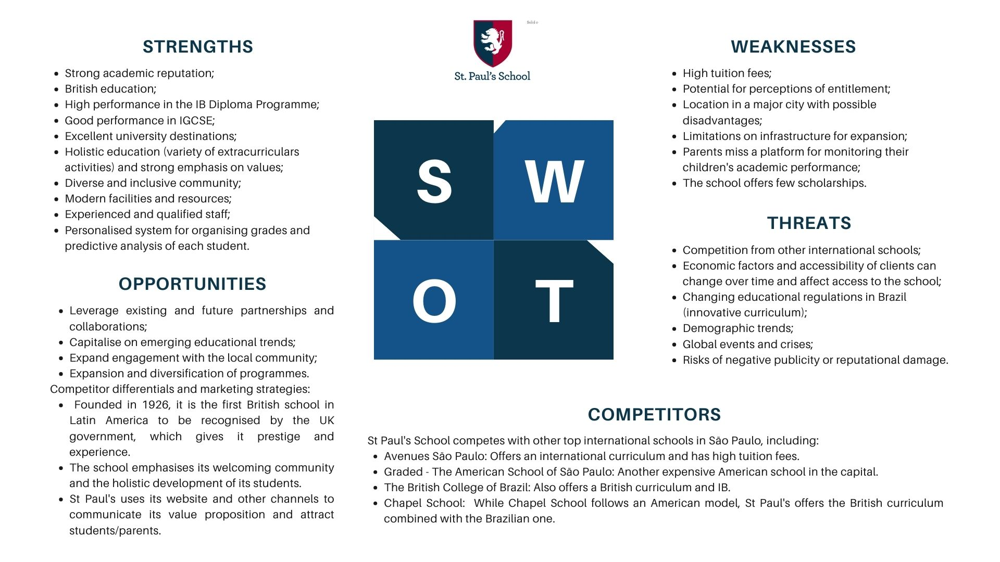
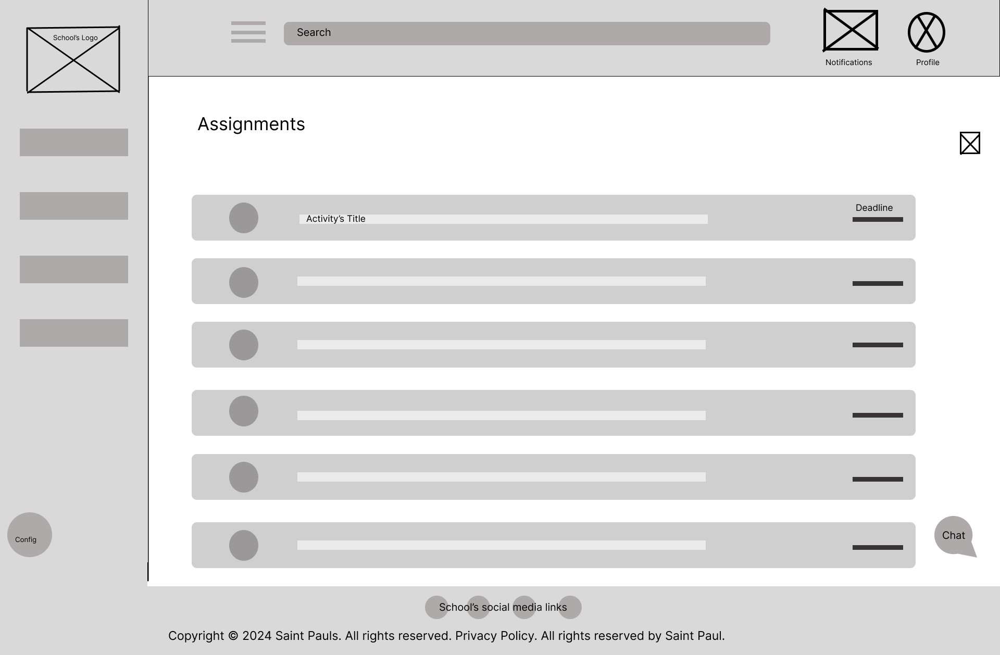

# WAD - Web Application Document - 2nd Module - Inteli

<!-- **_Os trechos em itálico servem apenas como guia para o preenchimento da seção. Por esse motivo, não devem fazer parte da documentação final_** -->

## Group name: CrownMates
## Project name: Diana

#### Group members' names:

- <a href="https://www.linkedin.com/in/anneestherlf/">Anne Esther Lins Figueirôa</a>
- <a href="https://www.linkedin.com/in/giacomo-zema-matizonkas-7ab9072b2/">Giacomo Zema Matizonkas</a>
- <a href="https://www.linkedin.com/in/jaime-andrade-de-almeida-0777ba2a5/">Jaime Andrade de Almeida</a> 
- <a href="https://www.linkedin.com/in/karolbarbosarocha/">Karol Rocha Barbosa</a> 
- <a href="https://www.linkedin.com/in/let%C3%ADcia-saravia-619b73345/">Leticia Fernandes do Espírito Santo Saravia</a>
- <a href="https://github.com/nicholasmillani">Nicholas Anantha Krishnan Millani</a> 
- <a href="https://www.linkedin.com/in/victor-garcia-dos-santos/">Víctor Garcia dos Santos</a>

## Summary

[1. Introduction](#c1)

[2. Overview of the Web Application](#c2)

[3. Web Application's Technical Project](#c3)

[4. Web Application Development](#c4)

[5. Web Application Tests](#c5)

[6. Market Research and Marketing Plan](#c6)

[7. Conclusions and future work](#c7)

[8. References](c#8)

[Appendices](#c9)

 

# 1. Introduction (sprints 1 to 5)

&nbsp;&nbsp;&nbsp;&nbsp;St. Paul’s is a reference in British education in Brazil, and it is the first school to receive the British School Overseas certification in Latin America. Located in São Paulo since 1926, the institution offers an Anglo-Brazilian curriculum for students from 3 to 18 years old, combining academic excellence with a multicultural and bilingual education. The school aims to innovate and maintain its quality education, and recently identified an opportunity to improve communication with the parents of its students.

&nbsp;&nbsp;&nbsp;&nbsp;Currently, if a parent wants to check if their child has submitted a homework assignment or missed a class, they need to access the school's app and navigate through different menus. However, this app has limitations: information such as class schedules, absences, event notices, and homework assignments are not always available or easily accessible, making it difficult to track their child’s school life.

&nbsp;&nbsp;&nbsp;&nbsp;To solve these challenges, St. Paul’s proposed a challenge to first-year students at Inteli: to develop a web portal exclusively for the parents. The proposal is to build a platform with simple navigation, accessible via browser, clear and intuitive. The portal will include login, personal student data, class schedules, absence control, and academic performance reports. With the new solution, this information will be visible on the homepage, with real-time updates, making it easier to monitor with just a few clicks.

&nbsp;&nbsp;&nbsp;&nbsp;By simplifying access to information, the portal allows parents to monitor their child’s school routine in just a few clicks, reducing the time spent searching through different communication channels. They will be able to quickly consult important data without relying on confusing channels, saving time and effort in their daily lives. With everything gathered in one practical platform, communication with the school will become more efficient. Thus, the platform not only centralizes data but also adds real value to the parents’ experience, promoting a more transparent and practical relationship between family and school.

&nbsp;&nbsp;&nbsp;&nbsp;The project takes into account the main concerns reported by parents regarding the current structure of the school. The solution seeks to add value to the school community, promoting more efficient communication and encouraging a more active participation of parents in their children’s educational journey.

 

  
  Figure 01 - St. Paul's Student

  
   
   
  
   
   

  
  Source: partner's website (2025)
  

 

# 2. Overview of the Web Application (sprint 1)

## 2.1. Project Scope (sprints 1 & 4)

### 2.1.1. 5 forces of Porter's model (sprint 1)

 

  
  Figure 02 - Porter's 5 forces

  
   
   
  
   
   

  
  Source: authors and partner's website (2025)
  

 

**1. Threat of New Entrants → LOW**
Very high entry barriers: Paul’s has held official recognition from the British Crown since 2012, being the first school in South America to receive this endorsement. This grants the school a high level of exclusivity and institutional authority, along with a legacy since 1926, robust infrastructure, and prestige. 

The bilingual curriculum, IB programs, and internationally qualified staff require significant expertise and investment. 

High parent loyalty further discourages switching.

**2. Threat of Substitutes → MODERATE**
Indirect competition: Other bilingual/international schools (e.g., Avenues, Chapel, Graded) lack Crown recognition, weakening their legitimacy. 

Online education has limited appeal in this premium segment, and the symbolic value of a British diploma for top universities is hard to replace.

**3.  Bargaining Power of Suppliers → MODERATE**
Key suppliers: bilingual and internationally trained teachers, educational technology companies, and outsourced services.

&nbsp;&nbsp;&nbsp;&nbsp;The school attracts talent through its strong brand name and offers good contractual conditions, reducing dependence on specific suppliers. However, top-tier teachers retain bargaining power as they can move to other elite institutions.

&nbsp;&nbsp;&nbsp;&nbsp;In areas such as educational technology (e.g., platforms tailored to the British curriculum), there may be greater dependence. High-end platforms adapted to British or IB curricula have limited providers and thus stronger pricing power.

&nbsp;&nbsp;&nbsp;&nbsp;Imported educational materials (like British textbooks and IB-specific resources) may be subject to currency fluctuations and logistical issues, increasing dependency.

**4. Bargaining Power of Customers (Parents and Students) → MODERATE**

&nbsp;&nbsp;&nbsp;&nbsp;Demanding and selective clientele: High-income families focused on international education are vocal about their expectations and standards.

&nbsp;&nbsp;&nbsp;&nbsp;However, the prestige and authority of the official British seal make St. Paul’s an aspirational choice, which limits the direct negotiation power of families.

&nbsp;&nbsp;&nbsp;&nbsp;Institutional exclusivity:
 St. Paul’s is one of the few officially British schools in South America, which drastically limits direct substitute options.

&nbsp;&nbsp;&nbsp;&nbsp;Recognition by the British Crown provides both symbolic and practical prestige that is not easily replicated.

&nbsp;&nbsp;&nbsp;&nbsp;High demand, limited seats:
 The school keeps small class sizes and a limited number of admissions, which creates demand that exceeds supply.

&nbsp;&nbsp;&nbsp;&nbsp;Strong reputation for results:
 The school’s track record in preparing students for universities in the UK, the US, and elsewhere reinforces parental trust in its educational model.

**5. Rivalry Among Existing Competitors → HIGH  (but mitigated by advantage)**
Competitors (Graded, Chapel, Avenues) target similar students but lack British recognition. St. Paul’s unique status reduces direct comparability, solidifying its leadership in the elite education market.

### 2.1.2. SWOT Analysis of the Partner Institution (sprint 1)

&nbsp;&nbsp;&nbsp;&nbsp;St Paul's School boasts a strong academic reputation and a comprehensive international curriculum, propelling its students to prestigious universities globally. Its holistic education and diverse community are strengths. However, the high cost of tuition limits accessibility and can generate perceptions of elitism. The school also faces challenges with its current infrastructure, which prevents significant expansion. Despite this, there are opportunities to strengthen partnerships, adopt innovative educational trends and increase engagement with the local community. Competition from other international schools and economic instability pose constant threats. This concludes the definition of the institution's SWOT analysis.

 

  
  Figure 03 - SWOT Analysis Chart
   
   
  
   
   

  
  Source: authors and partner's website (2025)
  

 

### 2.1.3. Solution (sprints 1 to 5)

**1. Problem to be solved**

&nbsp;&nbsp;&nbsp;&nbsp;The software currently used to access student records at the school is not effectively addressing the problems, especially for parents, who need a well-structured system to better visualize and closely follow their children's daily lives — including grades, assignments, homework, field trips, and more.

**2. Available data**

&nbsp;&nbsp;&nbsp;&nbsp;Alongside the TAPI (project deliverables document), we received the school’s brandbook for visual identity. For initial development, the partner provided mock data, including: "Pupils Contacts" (spreadsheet with fake details), profile photos, and 3 sample grade reports (PDF). We also obtained real data on student age range and total enrollment (Source: St Paul’s). This ensured privacy while allowing functional testing. 

**3. Proposed solution**

&nbsp;&nbsp;&nbsp;&nbsp;A new software solution that serves as a student history consultant, but in a simpler, more communicative, and direct way — truly making life easier for the parents who will use it. It will work as s manageable Parent Portal, with the academic information so that parents can access their children's reports, absences, communications, calendars and assigned tasks in a centralised way.

**4. How the solution will be used**

&nbsp;&nbsp;&nbsp;&nbsp;Log in via browser using your registered email and default password (schoolID — change it after first login). View your child’s profile, photo, and academic year, or switch between siblings. Check reports (PDF), attendance, and timetables. Assignments sync from Microsoft Teams. Update personal/medical details securely. Teachers’ contacts are listed for quick communication. A desktop-friendly alternative to the app, designed for clarity and convenience. 

**5. Expected benefits**

&nbsp;&nbsp;&nbsp;&nbsp;The portal enhances parental engagement by providing organized academic tracking, improving the school's reputation and reducing service congestion. Ahead of St. Paul’s 2026 centennial, this infrastructure renewal allows parents to monitor grades, attendance, and assignments efficiently while syncing academic calendars with family schedules. Centralized access empowers informed support for students’ progress. 

**6. Success criteria and how it will be evaluated**

&nbsp;&nbsp;&nbsp;&nbsp;The criterion for success is the full functionality of the software, which will be assessed by the approval of the general public of testers in this first restricted version of the software. The more specific indicators would be:

- Constant communication with parents;
- Positive feedback at meetings;
- Good personal organisation of families;
- Greater attendance at school events;
- Students getting closer to their guardians.

### 2.1.4. Value Proposition Canvas (sprint 1): 

&nbsp;&nbsp;&nbsp;&nbsp;The Value Proposition Canvas is a tool that helps to better understand what customers really need and how a solution can efficiently meet those needs. It is part of the broader model called the Business Model Canvas, used to structure ideas and businesses in a clear way. In the Value Proposition Canvas, the focus is on connecting what is offered (product or service) with the expectations, desires, and difficulties of the people who will use it. This allows for the development of solutions that are more aligned with what the audience truly values, increasing the chances of success in the market.

&nbsp;&nbsp;&nbsp;&nbsp;The structure of the Value Proposition Canvas is made up of two fundamental and complementary areas, which help us deeply understand the target audience and create more effective solutions:

**1. Customer Profile:** investigates the characteristics, needs, and expectations of the people who will use the product or service. This part is subdivided into three key elements:

**2. Customer Jobs:** describes what the customer needs to accomplish — their roles, goals, and activities that directly influence their routine and outcomes.

**3. Pains:** points out the obstacles, frustrations, or difficulties that hinder the efficient achievement of those tasks.

**4. Gains:** identifies the expected benefits, desired improvements, and the factors that truly create value for the customer.

**5. Value Proposition:** defines how the developed solution meets the demands of the audience, relieving pains and providing gains. This section is also divided into three components:

**6. Products and Services:** describes the offer created to meet the identified needs.

**7. Pain Relievers:** explains how the proposal helps solve or ease the challenges faced by the customer.

**8. Gain Creators:** presents the differentials and additional advantages offered, making the experience more positive and valuable.

&nbsp;&nbsp;&nbsp;&nbsp;By applying the Value Proposition Canvas in the context of St. Paul's, we ensure that our group's proposal is centered on the real needs of the user, promoting more relevant, engaging, and transformative solutions. This methodology allows us to align innovation and purpose, as well as to stimulate strategic thinking and the development of projects that generate a positive impact in line with the school's values.

&nbsp;&nbsp;&nbsp;&nbsp;Below is an image that shows each of the topics mentioned, presenting the proposal developed by the group:

 

  
  Figure 04 - Value Proposition Canvas
   
   
 "
   
   

  
  Source: authors and partner's website (2025)
  

 

&nbsp;&nbsp;&nbsp;&nbsp;Through the use of the Value Proposition Canvas, it was possible to clearly identify the users’ needs, relieve their pains, and generate concrete benefits. The solution presented stands out for its user-centered approach, promoting more meaningful, engaging experiences that are aligned with the values of the school. In this way, the project contributes not only to individual well-being, but also to strengthening the culture of innovation and collaboration at St. Paul’s.

### 2.1.5. Project Risk Matrix (Sprint 1)

&nbsp;&nbsp;&nbsp;&nbsp;According to Tomaz, Gagliasso, and Malavota (2020), the risk matrix is a management tool that assists a project team in identifying the risks and threats that may negatively affect its execution. It is constructed by combining the likelihood of each event occurring with the impact it would have if it materializes. Furthermore, these authors emphasize that developing a risk matrix is an iterative process: it is revisited at each work cycle to ensure that the mapping remains aligned with project changes. In this work, we have chosen to review and update our matrix at the beginning of each sprint.

&nbsp;&nbsp;&nbsp;&nbsp;Before presenting the Risk Matrix itself, it is important to explain how the information is structured. In the table below, we categorize the main risks identified for this sprint based on four elements:
- **Risk Description**: a brief summary of the potential threat.
- **Probability**: the likelihood of the risk occurring (classified as Low, Medium, High, or Very High).
- **Impact**: the severity of the consequences if the risk materializes (also classified as Low, Medium, High, or Very High).
- **Action Plan**: the strategies that will be adopted to mitigate or eliminate the identified risk.

&nbsp;&nbsp;&nbsp;&nbsp;These classifications help the project team prioritize actions and allocate resources effectively throughout the sprint.

 

  
  Figure 05 - Risk Matrix
   
   
  
   
   

  
  Source: authors and partner's website (2025)
  

 

#### 2.1.5.1. Risk Matrix

| Risk                                                         | Probability | Impact     | Action Plan                                                                                                                                                                                                                                                                                |
|--------------------------------------------------------------|------------:|-----------:|--------------------------------------------------------------------------------------------------------------------------------------------------------------------------------------------------------------------------------------------------------------------------------------------|
| **Leakage of sensitive data belonging to parents or students** | High        | Very High  | To mitigate the risk of sensitive data leakage, we will implement end-to-end encryption across all communication channels and storage.                                                                                                                                                     |
| **Performance issues or report latency**                     | Medium      | Medium     | To prevent performance issues, we will optimize database queries and indexes, adopt a caching layer for static reports, and monitor response-time indicators using APM tools configured with alerts for early detection of bottlenecks.                                                      |
| **Responsiveness failures on browsers/devices**               | Medium      | High       | To ensure responsiveness across various devices, we will apply responsive design based on a design system, conduct both manual and automated tests on popular browsers, and review the interface at each sprint before releasing new versions.                                               |
| **Non-compliance with accessibility requirements**           | Low         | Medium     | To ensure compliance with accessibility standards, we will perform testing with users who have special needs.                                                                                                                                                                               |
| **Low parental adoption and engagement (non-intuitive UX)**  | Low         | Very High  | To increase parental adoption, we will conduct usability sessions with real users, iterate on prototypes based on feedback, and develop onboarding materials along with synchronous training sessions to facilitate platform use.                                                             |

#### 2.1.5.2. Opportunity Matrix

&nbsp;&nbsp;&nbsp;&nbsp;Identifying opportunities is just as important as mapping risks, as it can significantly enhance the success and value generated by the project. In the Opportunity Matrix below, we categorize the main opportunities detected for this sprint based on four elements:
- **Opportunity Description**: a brief summary of the favorable scenario identified.
- **Probability**: the likelihood that the opportunity will materialize (classified as Low, Medium, High, or Very High).
- **Impact**: the potential positive effect on the project if the opportunity materializes (also classified as Low, Medium, High, or Very High).
- **Action Plan**: the steps that will be taken to capitalize on the opportunity and maximize its benefits.

&nbsp;&nbsp;&nbsp;&nbsp;By proactively addressing these opportunities, the project team aims not only to mitigate risks but also to strengthen user satisfaction, system functionality, and project visibility.

| Opportunity                                                  | Probability  | Impact    | Action Plan                                                                                                                                                                                                                                                        |
|--------------------------------------------------------------|-------------:|----------:|---------------------------------------------------------------------------------------------------------------------------------------------------------------------------------------------------------------------------------------------------------------------|
| **Increase in parental engagement**                          | Very High    | Very High | To capitalize on this opportunity, we will introduce gamification elements such as badges and achievements, send personalized progress reports at regular intervals, and organize online events to strengthen the connection between school and family.           |
| **Analytical dashboard with academic performance insights** | High         | High      | To deliver analytical value, we will gather requirements from teachers and coordinators, develop interactive visualizations (charts, heatmaps), and integrate real-time engagement and learning metrics.                                                            |
| **Embedded video tutorials within the portal**               | High         | Medium    | To facilitate the adoption of advanced features, we will produce targeted scripts and integrate them seamlessly into the user interface.                                                                                                                           |
| **Future integration with external calendars**               | Medium       | Low       | To extend the system’s utility, we will evaluate the APIs of Google Calendar and Microsoft Outlook for potential integration.                                                                                                                                     |
| **Implementation of an integrated chat between parents and teachers** | Low | High | To improve communication, we will prototype a chat solution using Socket.io or Firebase Realtime Database, establish clear moderation and privacy policies, and conduct controlled pilot tests prior to full deployment. |

&nbsp;&nbsp;&nbsp;&nbsp;This matrix will be reviewed at the beginning of each sprint, with probabilities, impacts, and action plans adjusted according to project progress.

## 2.2. Personas (sprint 1)

<!-- *Posicione aqui suas Personas em forma de texto markdown com imagens, ou como imagem de template preenchido. Atualize esta seção ao longo do módulo se necessário.* -->

&nbsp;&nbsp;&nbsp;&nbsp;In this section, we present 3 proto-personas representing potential users of the system. These personas, though hypothetical, are designed to reflect real user needs, pain points, and behaviors in the context of the problem being addressed. By defining these personas, we aim to align the product development process with user expectations, ensuring that the solution is both relevant and effective. The personas follow a structured template, maintaining clarity and coherence with the project’s objectives.

 

  
  Figure 06 - The Father (persona)
   
   
  
   
   

  
  Source: authors (2025)
  

 

 

  
  Figure 07 - The IT Analyst (persona)
   
   
  
   
   

  
  Source: authors (2025)
  

 

 

  
  Figure 08 - The Marketing Manager (persona)
   
   
  
   
   

  
  Source: authors (2025)
  

 

&nbsp;&nbsp;&nbsp;&nbsp;The defined personas provide a clear understanding of the target users, their challenges, and their expectations from the system. Each persona represents a distinct access level within the system, reinforcing the importance of access hierarchy — a fundamental concept in information security, particularly in IT network environments. This hierarchy determines which users or groups have permission to access specific resources, ensuring proper control and security.

&nbsp;&nbsp;&nbsp;&nbsp;By aligning these personas with their respective access roles, we establish a structured foundation for defining system permissions. In the next section (User Stories), these access-related functionalities will be further detailed, as the requirements were derived directly from the three personas presented here. This ensures that security constraints, role-based actions, and user needs are cohesively integrated into the system's design.

&nbsp;&nbsp;&nbsp;&nbsp;Future iterations may refine these personas and their access levels based on real user feedback and evolving security requirements, maintaining both usability and compliance.

## 2.3. User Stories (sprints 1 a 5)

&nbsp;&nbsp;&nbsp;&nbsp;User stories are short, simple descriptions of a feature or functionality that a software system should have, written from the perspective of the end user. By focusing on their POV, user stories ensure that the software being developed addresses real-world problems.

Identification | US01 
--- | ---
Persona | Júlio Oliveira
User Story | "As an IT Analyst, I want to access comprehensive project documentation, so I can fully understand the system's architecture and functionalities to proceed with development and troubleshooting effectively"
Acceptance Criteria 1 | **Scenario**: The IT Analyst accesses the project documentation. **Test:** The documentation should be well-structured, covering system architecture, API references, database schemas, and deployment guidelines.
Critérios INVEST | **Independent::** Can be implemented without dependency on other features. **Negotiable:** Details (format, tools) can be adjusted (e.g., Markdown, Confluence, or Swagger). **Valuable:** Ensures smoother development and maintenance. **Estimable:** Effort to create/improve documentation can be estimated. **Small:** Can be broken into smaller tasks (e.g., "Document API endpoints"). **Testable:** Verifiable by checking if docs exist, are updated, and are useful.

Identification | US02
--- | ---
Persona | Carolina Mendes
User Story | "As the school’s marketing manager, I want to offer an access to clear information about the enrollment process, so that the family can organize themselves from the very beginning."
Acceptance Criteria 1 | **Scenario:** A new family accesses the platform for the first time. **Acceptance Test:** The platform presents an interactive guide with basic school information, contacts, and calendar.
Acceptance Criteria 2 | **Scenario:** The family wants to review the onboarding information later. **Acceptance Test:** There should be a button/menu to access the welcome content again.

Identification | US03
--- | ---
Persona | Júlio Oliveira
User Story | "As a moderator, I want to ensure that every student receives all necessary information accurately from their very first interaction, preventing delays or issues caused by communication errors."
Acceptance Criteria 1 | **Scenario:** A student accesses the platform for the first time. **Acceptance Test:** The system verifies that all required information fields are completed before allowing the student to proceed.
Acceptance Criteria 2 | **Scenario:** A student needs additional help after initial interaction. **Acceptance Test:** The system logs all support requests and ensures a response is provided within.

Identification | US04
--- | ---
Persona | Daniel Thompson
User Story | "As a father who is searching for the balance between a new executive position and the proper attention directed to my son's trail, I'd like to access his academic information (reports, benes, sanctions, attendance rate, timetable) in a single platform, so that I can stay involved in his school life considering my heavy schedule."
Acceptance Criteria 1 | **Scenario:** The father logs into the platform with valid credentials. **Acceptance Test:** The platform displays grades, attendance, and recent activities in a clear and organized manner.
Acceptance Criteria 2 | **Scenario:** The father tries to access the system without being authenticated. **Acceptance Test:** The system redirects to the login screen and blocks access to student information.
Critérios INVEST | **Independent:**  The story describes a standalone feature that doesn’t depend on other fetures. **Negotiable:** The details ,such as design, data, and delivery, can be negotiated. **Valuable:** It provides value to the parent by offering a platform to stay involved in their son’s academic life. **Estimable:** The technical work involved is clear enough for estimation. **Small:** The scope of this story is clear and achievable within a short time. **testable** It can be tested by checking if the marketing manager can successfully use the interface to publish school news.

Identification | US05
--- | ---
Persona | Daniel Thompson
User Story | "As a parent, I wish there was a simple place where I could easily follow my daughter’s grades, attendance, and school updates without feeling lost in complicated websites (poor UI/UX)."
Acceptance Criteria 1 | **Scenario:** The parent navigates through the dashboard. **Acceptance Test:** Information is organized into clearly defined tabs or sections (Grades, Attendance...).
Acceptance Criteria 2 | **Scenario:** There is an error retrieving student data. **Acceptance Test:** The system displays a friendly error message and offers a retry option.
Critérios INVEST | **Independent:**  its standalone, focusing only on a parent’s access to their child’s school data. **Negotiable:** layout, types of data, and presentation style can be negotiated. **Valuable:** It delivers significant value by helping parents easily track academic progress and school updates. **Estimable:** The effort required to build the tracking system can be estimated. **Small:** The story is focused on one specific need, making it manageable in size. **testable** it can be tested by ensuring parents can view grades, attendance, and updates.

Identification | US06
--- | ---
Persona | Carolina Mendes
User Story | "As the school’s marketing manager, I want a simple interface to publish school news, so that I can easily share updates with the school community."
Acceptance Criteria 1 | **Scenario:** The manager accesses the admin panel and fills out the new post form. **Acceptance Test:** When all required fields are filled and "Publish" is clicked, the news should appear on the website under the news section.
Acceptance Criteria 2 | **Scenario:** The manager leaves a required field blank. **Acceptance Test:** The system should display a message indicating the missing fields and not allow submission until they are filled.
Critérios INVEST | **Independent:**  This task does not rely on other features or systems to work. **Negotiable:** The details of how the interface looks or functions are not strictly defined. **Valuable:** It makes it easier for the marketing manager to publish updates, which helps improve communication with the community. **Estimable:** can be estimated the effort needed to create a simple interface for publishing news. **Small:** it might need to be broken down into sSmall:er stories **testable** It can be tested by checking if the marketing manager can successfully use the interface to publish school news.

Identification | US07
--- | ---
Persona | Carolina Mendes
User Story | "As the school’s Marketing Manager, I need to be able to delete or edit a publication from the website, so I can remove any outdated or incorrect information."
Acceptance Criteria 1 | **Scenario:** The marketing manager is logged into the admin panel. **Acceptance Test:** When clicking the "Delete" button on a publication, it should be permanently removed from the website and no longer appear in the list of publications.
Acceptance Criteria 2 | **Scenario:** The manager tries to delete a publication that doesn’t exist or has already been deleted. **Acceptance Test:** The system should display an error message indicating that the publication was not found.
Critérios INVEST | **Independent::**  delete a publication doesn’t rely on other features. **Negotiable:**  the process of giving permission can be negotiated. **Valuable:**  it provides value by maintaining the accuracy of the website, ensuring the information is up-to-date. **Estimable:**  its a small task its time to be completed can be determined/estimated. **Small:** its a concise user storie that focus on a single action. **testable** it can be tested, just needs one person to delete a post.

Identification | US08
--- | ---
Persona | Daniel Thompson
User Story | "As a parent I want to easily find the school contact (and teachers' contacts), so that I can reach the school when needed."
Acceptance Criteria 1 | **Scenario:** The parent accesses the school website/platform. **Acceptance Test:** The school’s contact info (phone, email, address) should be visible within two clicks. Then, the school’s teachers info (phone, email, address) should be visible within one click.
Acceptance Criteria 2 | **Scenario:** The parent clicks or copies the contacts info. **Acceptance Test:** The phone number should open the default email app.

Identification | US09
--- | ---
Persona | Daniel Thompson
User Story | "As a parent, I need to be able to change my contact number, so the school can contact me if needed."
Acceptance Criteria 1 |**Scenario:** The parent accesses their profile. **Acceptance Test:** The "phone number" field should be editable, and the new number should be saved upon confirmation.
Acceptance Criteria 2 | **Scenario:** The parent enters an invalid phone number format. **Acceptance Test:** The system validates the format and shows an error message, preventing submission.

Identification | US10
--- | ---
Persona | Júlio Oliveira
User Story | "As an IT Analyst, I want to be able to manage the parent platform in such a way as to be able to combat any technological failures and promote quality support for the members of the school community who use the platform."
Acceptance Criteria 1 | **Scenario:** A technical failure occurs on the parent platform. **Acceptance Test:** The platform logs the incident automatically and notifies the IT Analyst.
Acceptance Criteria 2 | **Scenario:** A parent reports an issue through the support channel. **Acceptance Test:** The IT Analyst receives the ticket, can view issue details, assign priority, and update the status, ensuring that resolution steps are documented and communicated.
Critérios INVEST | **Independent:** describes a distinct requirement for managing the platform, with no dependency on other user stories. **Negotiable:** methods or tools used for managing failures and providing support can be adjusted, allowing for flexibility in implementation. **Valuable:** ensures that the platform remains functional and efficient, benefiting the entire school community. **Estimable:** can be estimated with clarity. **Small:** it can be broken down into smaller tasks. **Testable:** It can be tested by measuring the IT system’s reliability and responsiveness to issues.

Identification | US11
--- | ---
Persona | Júlio Oliveira
User Story | "As a moderator, I need to be able to manage user’s roles and permissions, so each member can only access what they need."
Acceptance Criteria 1 | **Scenario:** The moderator accesses the user management panel. **Acceptance Test:** The system allows changing a user's role with just a few clicks.
Acceptance Criteria 2 | **Scenario:** The moderator tries to assign an invalid role. **Acceptance Test:** The system prevents the action and displays a clear message about the invalid permission.

&nbsp;&nbsp;&nbsp;&nbsp;This section presented 11 user stories aligned with the previously defined personas, ensuring the system addresses real user needs while maintaining security through role-based access control. Each story follows the INVEST criteria, making them actionable for development in Sprints 1 to 5.

&nbsp;&nbsp;&nbsp;&nbsp;We constantly refine these requirements into technical tasks, ensuring a smooth transition from user needs to implemented features. By maintaining this structured approach, we ensure the final product remains user-centric, secure, and efficient.

# 3. Web Application's Technical Project (sprints 1 a 4)

## 3.1. Architecture (sprints 3 e 4)

*Posicione aqui o diagrama de arquitetura da sua solução de aplicação web. Atualize sempre que necessário*

## 3.2. Wireframes (sprint 2)

&nbsp;&nbsp;&nbsp;&nbsp;Now we will present the wireframes of our website. A wireframe [1] is a simplified, two-dimensional visual representation of a web page’s layout and structure, focusing on the arrangement of elements such as navigation, content areas, headers, and footers, without involving colors, images, or detailed design. Wireframes serve as the foundational blueprint or skeleton of a website, outlining its structure and functionality early in the design process.

&nbsp;&nbsp;&nbsp;&nbsp;The importance of wireframes lies in their ability to clarify the platform’s architecture and user flow, allowing designers and stakeholders to align ideas and expectations before investing time in visual design and development. By focusing on usability and content hierarchy, wireframes help identify and solve potential navigation or layout issues early, saving time and resources later in the project. They also facilitate effective communication among team members and clients by providing a clear, visual guide of how the site will function and how users will interact with it.

&nbsp;&nbsp;&nbsp;&nbsp;In summary, these wireframe sketches guide us in organizing all elements coherently, testing the user journey, and ensuring the platform meets both user needs and business goals before moving on to the final design phase.

**1. Login and About**
**Description:**  
&nbsp;&nbsp;&nbsp;Login screen with buttons for authentication, password recovery, and access to institutional information.  
- **[Login]** sends credentials for secure authentication.  
  — **US04 & US05**: Ensures protected access to student information.  
  — **US08**: First point of contact for new users accessing the platform.  
- **[Forgot your password?]** redirects to the password recovery page.  
  — **US04**: Ensures continuous access for busy parents.  
- **[About the school]** displays school mission, values, and contact details.  
  — **US07**: Supports onboarding for new families.
---

 

  
  Figure 09 - Login screen 
   
   
  
   
   

  Source: authors (2025)
  

 

**2. Profile - Homepage**
**Description:**  
&nbsp;&nbsp;&nbsp;User profile page with options to edit, save, or cancel updates to personal information.  
- **[Edit Profile]** enables editing of phone number, address, and other details.  
  — **US11**: Allows updating contact information.  
- **[Save]** confirms and stores changes made to the profile.  
  — **US11**: Ensures updated data is recorded.  
- **[Cancel]** discards any modifications made.  
  — Supports usability by preventing unwanted edits.

---
 

  
  Figure 10 - Profile 
   
   
 
   
   

  Source: authors (2025)
  

 

**3. Assignments**
**Description:**  
&nbsp;&nbsp;&nbsp;Task tracking page with filtering and completion tools.  
- **[Filter by subject]** displays tasks by selected subject.  
  — **US04 & US05**: Helps parents follow academic progress.  
- **[Mark as completed]** (check icon) marks a task as finished.  
  — **US05**: Allows parents to verify student task completion.

---
 

  
  Figure 11 - Assignments 
   
   

   
   

  Source: authors (2025)
  

 

**4. Reports Page**
**Description:**  
&nbsp;&nbsp;&nbsp;Academic performance page with options to view and export report cards.  
- **[Select Term]** (dropdown) filters academic reports by trimester or semester.  
  — **US04**: Enables quick review of grades over time.  
- **[Download PDF]** exports the report for offline access.  
  — **US04 & US05**: Useful for sharing and personal records.  
- Additional components: average grade chart per subject, table with subjects, semester, and grades; notification icon, profile button, and search bar.

---
 

  
  Figure 12 - Reports 
   
   

   
   

  Source: authors (2025)
  

 

**5. Timetable (Class Schedule)**
**Description:**  
&nbsp;&nbsp;&nbsp;Timetable screen showing the student’s schedule.  
- **[Day / Week]** toggles between daily and weekly views.  
  — **US04 & US05**: Provides a clear view of the student’s routine.

---
 

  
  Figure 13 - Timetable 
   
   
_reviewed.png)
   
   

  Source: authors (2025)
  

 

**6. School Events for Parents**
**Description:**  
&nbsp;&nbsp;&nbsp;Event feed for parents with RSVP functionality.  
- Each event opens a detailed description and lets parents confirm attendance.  
  — **US05 & US07**: Keeps parents informed and engaged in school activities.

---
 

  
  Figure 14 - Events 
   
   

   
   

  Source: authors (2025)
  

 

**7. Customer Service Channels**
**Description:**  
&nbsp;&nbsp;&nbsp;Support area with contact options for technical or administrative help.  
- **[New Support Request]** opens a live chat with the school office.  
  — **US06**: Provides direct and efficient technical support.  
- **[Check Ticket Status]** shows the progress of submitted requests.  
  — **US06 & US08**: Ensures transparency and follow-up ease.  
- **[Contact via Email/Phone]** launches email or phone apps with teacher contact details.  
  — **US10**: Allows direct communication between parents and the school.

---
 

  
  Figure 15 - Customer Service Channels 
   
   

   
   

  Source: authors (2025)
  

 

**8. Benes and Sanctions**
**Description:**  
&nbsp;&nbsp;&nbsp;Behavioral tracking screen displaying merits and warnings.  
- **[View Full History]** reveals all recorded events for a student.  
  — **US04 & US05**: Allows parents to monitor their child’s behavior.  
- Features include: student selection, count of merits and sanctions, comparative chart, and access to related reports.

 

  
  Figure 16 - Benes and sanctions 
   
   

   
   

  Source: authors (2025)
  

 

&nbsp;&nbsp;&nbsp;Here is the Figma link to view all the wireframes (wireflow) and check more comments about each functionality: 
https://www.figma.com/design/Qrb4vjSeXfNiWN9iirHvdN/Diagrama-de-fios-Diana-?node-id=0-1&t=hnUIIUZ5UoUYsqvq-1

&nbsp;&nbsp;&nbsp;&nbsp;These wireframes helped us visualize and validate the website structure, ensuring that the navigation and layout align with the project goals. With this foundation in place, we can confidently move on to the next stage of the design process.

## 3.3. Style guide (sprint 3)

*Descreva aqui orientações gerais para o leitor sobre como utilizar os componentes do guia de estilos de sua solução*

### 3.3.1 Colors

*Apresente aqui a paleta de cores, com seus códigos de aplicação e suas respectivas funções*

### 3.3.2 Typography

*Apresente aqui a tipografia da solução, com famílias de fontes e suas respectivas funções*

### 3.3.3 Iconography and images

*(esta subseção é opcional, caso não existam ícones e imagens, apague esta subseção)*

*posicione aqui imagens e textos contendo exemplos padronizados de ícones e imagens, com seus respectivos atributos de aplicação, utilizadas na solução*

## 3.4 High-fidelity prototype (sprint 3)

A high-fidelity prototype is a detailed representation of a product that closely resembles the final design in both appearance and functionality. It includes realistic visuals, accurate layout and typography.

## 3.5. Database modelling (sprints 2 e 4)

### 3.5.1. Relational model (sprints 2 e 4)

&nbsp;&nbsp;&nbsp;&nbsp;Relational database modeling is the process of designing the structure of a database based on the principles of the relational model. Its purpose is to organize all the information into tables and to clearly represent the relationships among them, ensuring data is structured, consistent, and easy to access.

 

  
  Figure 17 - Database Modelling 
   
   

   
   

  Source: authors (2025)
  

 

#### 3.5.1.1 Tables description:
**1.  Users table:**
**Purpose:** Stores login details for the parent who use the system.

**Main fields:**

- id: Unique identifier for each user;
- email: Email address (used to log in);
- password: Password (securely stored);
- type_of_user: Defines the user's role (e.g. teacher, tutor, admin).

**2. Teachers table:**
**Purpose:** Keeps information about school teachers.

**Main fields:**

- id: Unique ID for the teacher;
- teacher_name: Full name of the teacher;
- teacher_email: Contact email.

**3. Tutors table:**
**Purpose:** Stores information about tutors.

**Main fields:**

- id: Unique ID for the tutor;
- name_tutor: Full name;
- email: Contact email.

**Related to:** students and subjects. 

**4. Students table:**
**purpose:** Stores informaton about the students like grades, name, and gender.

- id: Unique student ID;
- student_name, student_surname: Student’s full name;
- gender, school_age, year_code: Basic school and personal info;
- tutor_id: Links to the student’s tutor;
- school_id: (Optional) School information;
- medical_flags: Any medical notes.

**Related to:** tutors (via tutor_id), student_subject (shows what they study), events and reports.

**5. Subjects table:**
**Purpose:** Lists all subjects offered at the school.

**Main fields:**

- id: Subject ID;
- subject_name: Name of the subject (e.g. Math, Science);
- teacher_id: Who teaches it.

**6. Student_subject table:**
**Purpose:** Connects students and subjects they are enrolled in.

**Main fields:**

- id: Unique ID;
- student_id: Student enrolled;
- subject_id: Subject enrolled in;
- grade: Grade received in that subject.

**7. Reports table:**
**Purpose:** Stores written reports about a student.

**Main fields:**

- id: Report ID;
- student_id: Who the report is about;
- date_report: When the report was created;
- Related to: students.

**8. Events table:**

**Purpose:** Logs any special events related to a student.

**Main fields:**

- id: Event ID;
- concept: Description of the event;
- student_id: Who the event is related to;
- Related to: students;

**9. Academic house table:**
**Purpose:** Storage all the academic houses from st Pauls(a sistem like Harry Potter)

**Main fields:**

- id: Unique identifier for the academic house;
- house: Name of the house.
- Related to: students (via academic_house_id).

**10. Year code:**

**Purpose:** Defines the academic year or grade level a student is currently in.

**Main fields:**

- id: Unique identifier for the year/grade;
- year_code: Label for the year (e.g., “Year 5”, “Grade 10”).
- Related to: students (via year_code_id).

&nbsp;&nbsp;&nbsp;&nbsp;The relational database model for Diana was designed to directly align with and support the project's key user stories. The student_subject and reports tables enable the academic tracking functionality required by US04 and US05, allowing parents to view their child's grades and performance metrics as specified in the acceptance criteria. These tables connect to the students table which maintains tutor relationships, ensuring parents have comprehensive oversight of their child's progress. The users table implements role-based permissions through its type_of_user field, directly addressing US06 by providing IT staff with the access control capabilities needed to manage accounts and troubleshoot issues according to the defined support scenarios. 

&nbsp;&nbsp;&nbsp;&nbsp;The events table supports US07's onboarding requirements by storing school activities and announcements that help new families integrate into the community. Medical information in the students table and contact details in both students and tutors tables fulfill US11's need for parents to update critical contact information. This intentional database design ensures each user story's functional requirements are properly supported through appropriate data relationships and access patterns while maintaining security and performance. The model's flexibility allows for future expansion to accommodate additional features while preserving its alignment with core user needs as defined in the project requirements.
  
### 3.5.2. SQL queries and propositional logic (sprint 2)

&nbsp;&nbsp;&nbsp;&nbsp;In the development of our web application for St. Paul's School, database interactions are critical to ensure efficient and accurate data retrieval, updates, and management. This section bridges SQL (Structured Query Language)—the standard language for relational database operations—with propositional logic, a foundational framework for expressing and evaluating logical conditions.

#1 | ---
--- | ---
**SQL Expression** | UPDATE student SET address = 'Rua Galeno de Almeida, 1200' WHERE (student_name = 'John' AND surname_student != 'Smith') AND (id = 24); 
**Logical propositions** | $A$: The address is 'Rua Galeno de Almeida, 1200' (address = 'Rua Galeno de Almeida, 1200')   $B$: The students name is John (student_name = 'John')   $C$: The id must be 24 (id = 24)
**Propositional logic expression** | $(A \land B) \land C$
**Truth Table** |   <table> <thead> <tr> <th>$A$</th> <th>$B$</th> <th>$C$</th> <th>$(A \land B)$</th> <th>$(A \land B) \land C$</th> </tr> </thead> <tbody> <tr> <td>F</td> <td>F</td> <td>F</td> <td>F</td> <td>F</td> </tr> <tr> <td>F</td> <td>F</td> <td>T</td> <td>F</td> <td>F</td> </tr> <tr> <td>F</td> <td>T</td> <td>F</td> <td>F</td> <td>F</td> </tr> <tr> <td>F</td> <td>T</td> <td>T</td> <td>F</td> <td>F</td> </tr> <tr> <td>T</td> <td>F</td> <td>F</td> <td>F</td> <td>F</td> </tr> <tr> <td>T</td> <td>F</td> <td>T</td> <td>F</td> <td>F</td> </tr> <tr> <td>T</td> <td>T</td> <td>F</td> <td>T</td> <td>F</td> </tr> <tr> <td>T</td> <td>T</td> <td>T</td> <td>T</td> <td>T</td> </tr> </tbody> </table>

&nbsp;&nbsp;&nbsp;&nbsp;This expression (#1) would be used when the necessity of updating an specific student's adress would appear, being exemplified by the use of "John", who wouldn't have the "Smith" surname (considering there is another student with this full name) and would have the ID 24 allocated for himself.

#2 | ---
--- | ---
**SQL Expression** | DELETE FROM subject WHERE (id LIKE '_1' OR name_subject IN ('Business & Management', 'Physics', 'Computer Science')) AND student_grade = 'Pre Prep' ; 
**Logical propositions** | $A$: The id must contain as its second algarism "1"   $B$: The subject name must be "Business & Management', 'Physics' or 'Computer Science'   $C$: The student's grade must be "Pre Prep"
**Propositional logic expression** | $(A \lor B) \land C$
**Truth Table** | <table> <thead> <tr> <th>$A$</th> <th>$B$</th> <th>$C$</th> <th>$(A \lor B)$</th> <th>$(A \lor B) \land C$</th> </tr> </thead> <tbody> <tr> <td>F</td> <td>F</td> <td>F</td> <td>F</td> <td>F</td> </tr> <tr> <td>F</td> <td>F</td> <td>T</td> <td>F</td> <td>F</td> </tr> <tr> <td>F</td> <td>T</td> <td>F</td> <td>T</td> <td>F</td> </tr> <tr> <td>F</td> <td>T</td> <td>T</td> <td>T</td> <td>T</td> </tr> <tr> <td>T</td> <td>F</td> <td>F</td> <td>T</td> <td>F</td> </tr> <tr> <td>T</td> <td>F</td> <td>T</td> <td>T</td> <td>T</td> </tr> <tr> <td>T</td> <td>T</td> <td>F</td> <td>T</td> <td>F</td> </tr> <tr> <td>T</td> <td>T</td> <td>T</td> <td>T</td> <td>T</td> </tr> </tbody> </table>

&nbsp;&nbsp;&nbsp;&nbsp;This expression (#2) would be used in a context in which a subject (Business & Management, Physics and Computer Science for example) is inappropriately assigned for a pre prep student, considering that his grade doesn't approach such a level of complexity yet.

#3 | —
--- | ---
**SQL Expression** | SELECT id, student_name, num_absences, grade, medical_flags FROM students  JOIN student_subject  ON student_id = .id WHERE (num_absences > 5 AND grade < 60) OR medical_flags = 'TRUE';
**Logical propositions** | $A$: num\_absences > 5   $B$: grade < 60   $C$: medical\_flags = TRUE
**Propositional logic expression** | $(A \land B) \lor C$
**Truth Table**  | <table> <thead> <tr><th>$A$</th><th>$B$</th><th>$C$</th><th>$(A \land B)$</th><th>$(A \land B) \lor C$</th></tr></thead><tbody><tr><td>F</td><td>F</td><td>F</td><td>F</td><td>F</td></tr><tr><td>F</td><td>F</td><td>T</td><td>F</td><td>T</td></tr><tr><td>F</td><td>T</td><td>F</td><td>F</td><td>F</td></tr><tr><td>F</td><td>T</td><td>T</td><td>F</td><td>T</td></tr><tr><td>T</td><td>F</td><td>F</td><td>F</td><td>F</td></tr><tr><td>T</td><td>F</td><td>T</td><td>F</td><td>T</td></tr><tr><td>T</td><td>T</td><td>F</td><td>T</td><td>T</td></tr><tr><td>T</td><td>T</td><td>T</td><td>T</td><td>T</td></tr></tbody></table>

&nbsp;&nbsp;&nbsp;&nbsp;This SQL statement (#3) highlights students who may need immediate academic attention by returning every learner with either more than five absences and an overall grade below 60, or active medical flag—helping teachers and advisors quickly locate those who require extra monitoring or support.

#4 | —
--- | ---
**SQL Expression**| SELECT id, grade, student_id FROM student_subject  JOIN students  ON student_id = id JOIN users u ON parent_id = id WHERE id = :parent_id AND grade IS NULL AND ((grade BETWEEN 0 AND 59) OR academic_house = 'alta');
**Logical propositions** | $D$: grade IS NULL   $E$: grade between 0 and 59   $F$: academic\_house = ‘alta’
**Propositional logic expression** | $D \land (E \lor F)$
**Truth Table** | <table> <thead> <tr><th>$D$</th><th>$E$</th><th>$F$</th><th>$(E \lor F)$</th><th>$(D \land (E \lor F))$</th></tr></thead><tbody><tr><td>F</td><td>F</td><td>F</td><td>F</td><td>F</td></tr><tr><td>F</td><td>F</td><td>T</td><td>T</td><td>F</td></tr><tr><td>F</td><td>T</td><td>F</td><td>T</td><td>F</td></tr><tr><td>F</td><td>T</td><td>T</td><td>T</td><td>F</td></tr><tr><td>T</td><td>F</td><td>F</td><td>F</td><td>F</td></tr><tr><td>T</td><td>F</td><td>T</td><td>T</td><td>T</td></tr><tr><td>T</td><td>T</td><td>F</td><td>T</td><td>T</td></tr><tr><td>T</td><td>T</td><td>T</td><td>T</td><td>T</td></tr></tbody></table>

&nbsp;&nbsp;&nbsp;&nbsp;This SQL statement (#4) focuses on a parent’s children, selecting each subject in which the recorded grade is still blank and the child either falls in the failing-grade (between 0 and 59) or belongs to the “alta” academic house, enabling parents and school staff to identify missing grades and cases for follow-up before report cards are finalized.

&nbsp;&nbsp;&nbsp;&nbsp;Moving forward, this methodology will guide future database enhancements, ensuring scalability and reliability as the platform evolves. 

## 3.6. WebAPI and endpoints (sprints 3 e 4)

*Utilize um link para outra página de documentação contendo a descrição completa de cada endpoint. Ou descreva aqui cada endpoint criado para seu sistema.* 

*Cada endpoint deve conter endereço, método (GET, POST, PUT, PATCH, DELETE), header, body e formatos de response*

# 4. Web Application Development

## 4.1. First version of the web application (sprint 3)

*Descreva e ilustre aqui o desenvolvimento da sua primeira versão do sistema web, explicando brevemente o que foi entregue em termos de código e sistema. Utilize prints de tela para ilustrar. Indique as eventuais dificuldades e próximos passos.*

## 4.2. Second version of the web application (sprint 4)

*Descreva e ilustre aqui o desenvolvimento da sua segunda versão do sistema web, explicando brevemente o que foi entregue em termos de código e sistema. Utilize prints de tela para ilustrar. Indique as eventuais dificuldades e próximos passos.*

## 4.3. Final version of the web application (sprint 5)

*Descreva e ilustre aqui o desenvolvimento da última versão do sistema web, explicando brevemente o que foi entregue em termos de código e sistema. Utilize prints de tela para ilustrar. Indique as eventuais dificuldades e próximos passos.*

# 5. Tests

## 5.1. Automated endpoint integration test report (sprint 4)

*Liste e descreva os testes unitários dos endpoints criados, automatizados e planejados para sua solução. Posicione aqui também o relatório de cobertura de testes Jest se houver (através de link ou transcrito para estrutura markdown)*

## 5.2. Usability tests (sprint 5)

*Posicione aqui as tabelas com enunciados de tarefas, etapas e resultados de testes de usabilidade. Ou utilize um link para seu relatório de testes (mantenha o link sempre público para visualização)*

# 6. Market Research and Marketing Plan (sprint 4)

## 6.1 Executive Summary

*Preencher com até 300 palavras, sem necessidade de fonte*

*Apresente de forma clara e objetiva os principais destaques do projeto: oportunidades de mercado, diferenciais competitivos da aplicação web e os objetivos estratégicos pretendidos.*

## 6.2 Market Analysis

*a) Visão Geral do Setor (até 250 palavras)*
*Contextualize o setor no qual a aplicação está inserida, considerando aspectos econômicos, tecnológicos e regulatórios. Utilize fontes confiáveis.*

*b) Tamanho e Crescimento do Mercado (até 250 palavras)*
*Apresente dados quantitativos sobre o tamanho atual e projeções de crescimento do mercado. Utilize fontes confiáveis.*

*c) Tendências de Mercado (até 300 palavras)*
*Identifique e analise tendências relevantes (tecnológicas, comportamentais e mercadológicas) que influenciam o setor. Utilize fontes confiáveis.*

## 6.3 Competitor Analysis

*a) Principais Concorrentes (até 250 palavras)*
*Liste os concorrentes diretos e indiretos, destacando suas principais características e posicionamento no mercado.*

*b) Vantagens Competitivas da Aplicação Web (até 250 palavras)*
*Descreva os diferenciais da sua aplicação em relação aos concorrentes, sem necessidade de citação de fontes.*

## 6.4 Target audience

*a) Segmentação de Mercado (até 250 palavras)*
Descreva os principais segmentos de mercado a serem atendidos pela aplicação. Utilize bases de dados e fontes confiáveis.*

*b) Perfil do Público-Alvo (até 250 palavras)*
*Caracterize o público-alvo com dados demográficos, psicográficos e comportamentais, incluindo necessidades específicas. Utilize fontes obrigatórias.*

## 6.5 Positioning

*a) Proposta de Valor Única (até 250 palavras)*
*Defina de maneira clara o que torna a sua aplicação única e valiosa para o mercado.*

*b) Estratégia de Diferenciação (até 250 palavras)*
*Explique como sua aplicação se destacará da concorrência, evidenciando a lógica por trás do posicionamento.*

## 6.6 Marketing Strategy 

*a) Produto/Serviço (até 200 palavras)*
*Descreva as funcionalidades, benefícios e diferenciais da aplicação*

*6.2 Preço (até 200 palavras)*
*Explique o modelo de precificação adotado e justifique com base nas análises anteriores.*

*6.3 Praça (Distribuição) (até 200 palavras)*
*Apresente os canais digitais utilizados para distribuir e entregar a aplicação ao público.*

*6.4 Promoção (até 200 palavras)*
*Descreva as estratégias digitais planejadas, como SEO, redes sociais, marketing de conteúdo e campanhas pagas.*

# 7. Conclusions and future work (sprint 5)

*Escreva de que formas a solução da aplicação web atingiu os objetivos descritos na seção 2 deste documento. Indique pontos fortes e pontos a melhorar de maneira geral.*

*Relacione os pontos de melhorias evidenciados nos testes com planos de ações para serem implementadas. O grupo não precisa implementá-las, pode deixar registrado aqui o plano para ações futuras*

*Relacione também quaisquer outras ideias que o grupo tenha para melhorias futuras*

# 8. References (sprints 1 a 5)

<!-- _Incluir as principais referências de seu projeto, para que seu parceiro possa consultar caso ele se interessar em aprofundar. Um exemplo de referência de livro e de site:_  -->

[1] Wireframes: o que é, qual a importância, tipos e ferramentas. Disponível em: https://rockcontent.com/br/blog/wireframes/. Acesso em: 28 mai. 2025.

.  

# Appendices

*Inclua aqui quaisquer complementos para seu projeto, como diagramas, imagens, tabelas etc. Organize em sub-tópicos utilizando headings menores (use ## ou ### para isso)*
